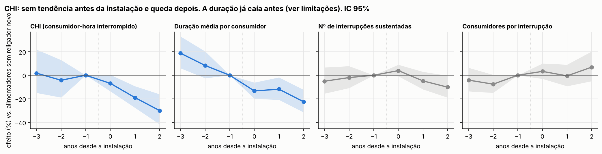
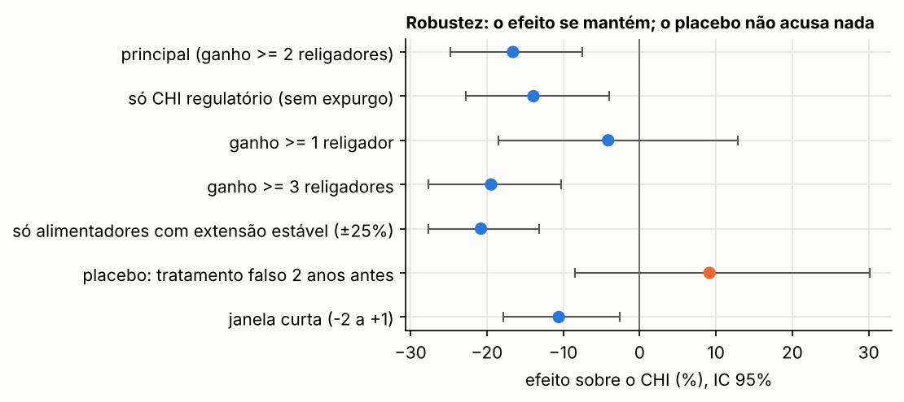
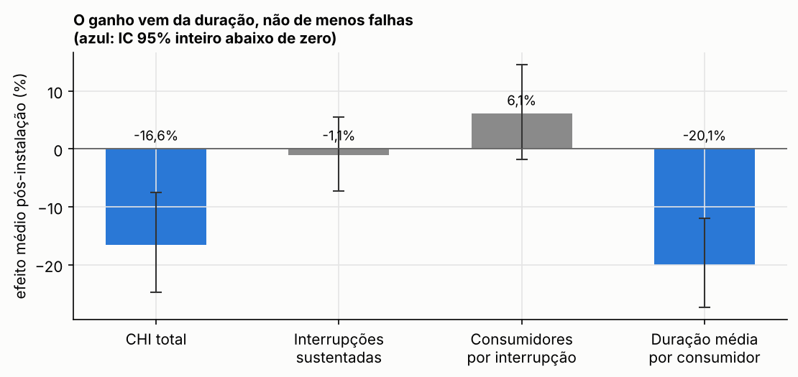
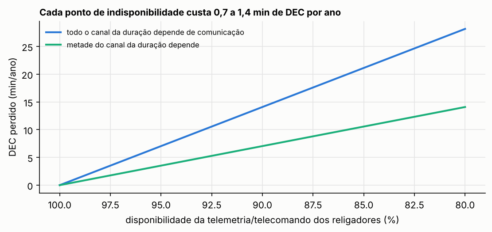
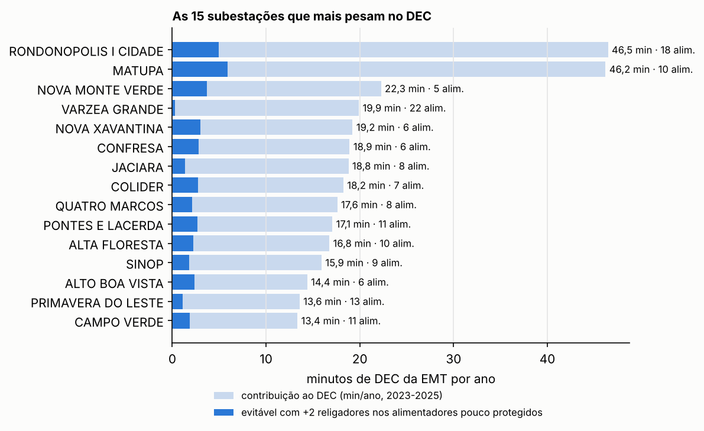
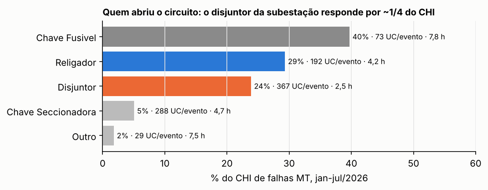

# Quanto vale um religador (e a telemetria dele)

[](https://github.com/CaioNepomuceno2/automation-impact/actions/workflows/ci.yml)

-0b7a75)

**Quanto DEC um religador realmente evita, quanto isso vale em R$ e quanto custa cada ponto percentual de
indisponibilidade da sua telemetria?**

Planos de investimento em automação costumam usar eficácias de catálogo. Aqui a eficácia é **medida**. São 8
cadastros anuais da rede da **Energisa Mato Grosso** (BDGD/ANEEL, 2018 a 2025) e 2,4 milhões de interrupções
(ANEEL). O método compara alimentadores que **ganharam religadores** com alimentadores parecidos que não
ganharam, antes e depois (diferenças em diferenças com efeitos fixos).

## Resultados em uma tela

| | |
|---|---|
| Efeito de ganhar religadores (evento típico: +2 a +5) sobre o CHI do alimentador | **−16,6%** (IC 95%: −24,8% a −7,5%; p < 0,001) |
| Dois anos depois da instalação | **−30%** (IC 95%: −42% a −16%) |
| CHI evitado por religador instalado | **≈ 4.600 consumidores-hora/ano** (IC 95%: 2.100 a 6.800), 0,13 min de DEC da EMT |
| Valor por religador | **R$ 27 mil/ano** na visão social; R$ 6,7 mil/ano só em compensações |
| VPL em 20 anos, religador de R$ 160 mil (custo ilustrativo) | **+R$ 107 mil** na visão social; **−R$ 94 mil** só com compensações |
| Por onde o efeito passa | pela **duração** da interrupção, não pelo número de falhas (os −20% na duração estão superestimados por uma tendência de queda anterior; ver Limitações) |
| Custo de **1 ponto percentual** de indisponibilidade da telemetria dos 4.000 religadores | **0,7 a 1,4 min de DEC/ano**; R$ 134 a 268 mil/ano (social) |
| As 10 subestações mais críticas (10% de 104) | concentram **33% do CHI** |



## 1. O efeito medido

**Desenho.** Um alimentador é "tratado" no primeiro ano em que o cadastro mostra 2 ou mais religadores novos
que permanecem nos cadastros seguintes. Ganhos que somem no ano seguinte são tratados como ruído
cadastral. São **116 eventos (493 religadores)** entre 2019 e 2025. Os controles são **209 alimentadores** cuja
quantidade de religadores nunca variou mais que 1. Cada coorte de tratamento vira um experimento
próprio (DiD empilhado), comparada só com os controles na mesma janela, de −3 a +2 anos. O estimador é
Poisson com efeitos fixos (PPML), com erros-padrão agrupados por alimentador.

**Por que acreditar.** No CHI, tratados e controles andam juntos nos três anos anteriores (−3: +1,8%;
−2: −4,3%; ambos não significativos). Depois da instalação, o efeito cresce: −6,9% no ano da entrada,
−19% no ano seguinte e −30% dois anos depois.



| Teste | Efeito sobre o CHI | IC 95% |
|---|---|---|
| Principal (ganho ≥ 2) | **−16,6%** | −24,8% a −7,5% |
| Só CHI regulatório (sem expurgos) | −13,9% | −22,8% a −4,0% |
| Ganho ≥ 3 religadores | −19,4% | −27,7% a −10,2% |
| Só alimentadores de extensão estável (±25%) | −20,8% | −27,7% a −13,2% |
| Janela curta (−2 a +1) | −10,6% | −17,9% a −2,6% |
| **Placebo:** tratamento falso 2 anos antes | +9,2% (n.s.) | −8,4% a +30,1% |
| Ganho ≥ 1 religador | −4,1% (n.s.) | −18,5% a +12,9% |

O placebo não acusa efeito, e o resultado fica mais forte quando se exclui alimentadores que mudaram de tamanho
(divisões e transferências de carga). Ganhos de um único religador não mostram efeito detectável. Eles se
misturam com acertos de cadastro, e um religador sozinho muda pouco num alimentador grande.

## 2. Por onde o efeito passa: duração, e é aí que a telemetria entra



O CHI é o produto de três fatores: número de interrupções × consumidores por interrupção × duração. No DiD,
o número de interrupções não muda (−1,1%, n.s.), os consumidores por interrupção também não (+6,1%, n.s.), e
a **duração média por consumidor cai 20%** (IC 95%: −27% a −12%).

O modelo de efeito por unidade, que usa toda a variação da frota com controle de extensão e de consumidores,
separa melhor os canais. Cada religador a mais reduz o CHI do alimentador em **2,2%** (IC 95%: −3,3% a −1,2%):

* **1,2% vêm de menos interrupções sustentadas**, o religamento automático transformando faltas
  transitórias em momentâneas. Esse canal é **local** e funciona sem comunicação.
* **1,3% vêm de restabelecimento mais rápido.** É o canal que depende de **supervisão**: o centro de operação
  sabe na hora que o religador abriu e qual trecho está fora, e despacha a equipe para o lugar certo. Pela
  decomposição, **57% do efeito passa pela duração**.

O tempo de atendimento da EMT reforça a leitura. Em 2025, nas 341 mil ocorrências emergenciais, **89% do tempo
foi preparo** (da abertura da ocorrência até o despacho da equipe; mediana de 4,7 h). O deslocamento foi 6% e a
execução, 5% ([ANEEL, Ocorrências Emergenciais](reports/atendimento_2025.csv)). O gargalo está em saber onde
está o defeito e ter equipe para ir, não na estrada.

## 3. Quanto custa a indisponibilidade da telemetria



**Premissa explícita:** o benefício que passa pela duração só existe enquanto o religador está supervisionado.
Se a telemetria fica fora 1% do tempo, perde-se 1% desse benefício. Aplicando o efeito marginal de cada
religador ao CHI do seu próprio alimentador (média 2023-2025), para os **4.000 religadores do cadastro de
dez/2025**:

| Fração do canal da duração que depende de comunicação | DEC perdido por 1 p.p. de indisponibilidade | R$/ano (visão social) | R$/ano (só compensações) |
|---|---|---|---|
| Todo o canal (57% do efeito) | **1,4 min/ano** | R$ 268 mil | R$ 70 mil |
| Metade do canal (29% do efeito) | **0,7 min/ano** | R$ 134 mil | R$ 35 mil |

Na prática, levar a disponibilidade da telemetria dos religadores de 95% para 99% vale de **3 a 6 minutos de DEC
por ano**. Isso transforma um indicador de TI de campo em um número que entra no plano de investimento.

## 4. Subestações: onde o risco se concentra e onde mais religadores rendem mais



* Das 104 subestações, **as 10 mais críticas concentram 33% do CHI** de falhas de MT (2023-2025).
  **Rondonópolis I Cidade** e **Matupá** pesam, cada uma, cerca de **46 minutos** no DEC anual da EMT.
* **Onde mais religadores rendem:** 199 alimentadores têm 30 km ou mais e menos religadores que a mediana
  (1,9 por 100 km). Com **+2 religadores em cada um** (o ganho mediano dos eventos), o investimento seria de
  R$ 64 mi a R$ 160 mil por unidade, e o efeito medido evitaria **78 min de DEC por ano** e **R$ 16,6 mi/ano** na
  visão social (VPL de +R$ 100 mi em 20 anos). É uma extrapolação do efeito médio, ilustrativa. O ranking por
  subestação está em [`reports/subestacoes.csv`](reports/subestacoes.csv).
* **Quem abriu o circuito em 2026 (jan-jul):** a ANEEL passou a publicar o equipamento que interrompeu.

  

  * Disjuntor de saída da subestação: **24% do CHI**, com 367 consumidores por evento e duração média de 2,5 h.
  * Religadores de linha: 29% do CHI, com 192 consumidores por evento e 4,2 h.
  * Chaves fusíveis: 40% do CHI, com 73 consumidores por evento e 7,8 h, o que deixa claro onde está a demora.

## 5. O que muda nas premissas de planejamento

O projeto irmão [`distribution-asset-risk`](https://github.com/CaioNepomuceno2/distribution-asset-risk) otimiza a
carteira de investimentos com eficácias **ilustrativas**. Com os dados:

| Intervenção | Premissa (redução do CHI do alimentador) | Medido | Leitura |
|---|---|---|---|
| Religador (pacote) | −22,5% (eficácia 0,45 × alcance 0,5) | **−16,6%** (IC −24,8% a −7,5%) | ordem de grandeza confirmada; ponto central ~25% menor |
| Telecomando (2 chaves) | −21% (eficácia 0,35 × alcance 0,6) | **+1,7%** (IC −1,8% a +5,4%) | **não sustentado** pelo cadastro (ver limitações) |

**Resultado-chave:** o religador se paga na visão social (payback de cerca de 6 anos), mas **não se paga só com
compensações**. É a mesma conclusão do projeto irmão, agora com eficácia medida.

## Decisões de dados

Detalhes em [`docs/dados.md`](docs/dados.md). As principais:

* **Alimentador canônico = nome operacional do circuito** (`CTMT.NOME`). O `COD_ID` da BDGD mudou entre 2022 e
  2023, e o crosswalk de códigos vem do `distribution-asset-risk`.
* **Cadastro de 31/12 de y-1 explica a continuidade de y.** O religador que aparece no cadastro de dez/2022
  conta como presente em 2023 inteiro.
* **A data de conexão do religador não serve para datar a instalação.** No cadastro de 2025, 2.100 dos 4.060
  religadores têm conexão em 2024, um recadastramento. Por isso o tratamento vem da diferença entre snapshots,
  não do campo `DAT_CON`.
* **Telecomando (`TLCD`) é instável no cadastro.** Os religadores marcados como telecomandados caem de 1.142 para
  811 entre os cadastros de 2022 e 2023, sem contrapartida física plausível. O efeito do telecomando cadastral
  é reportado, mas não sustenta conclusão.

## Reproduzir

Este projeto reaproveita as saídas do [`distribution-asset-risk`](https://github.com/CaioNepomuceno2/distribution-asset-risk):
interrupções harmonizadas, crosswalk de circuitos, atributos da BDGD e R$/CHI. Rode aquele pipeline primeiro, ou
aponte `configs/emt.yaml` para os arquivos.

```bash
pip install -e ".[dev]"
python scripts/01_build_equipamentos.py   # religadores, telecomando e disjuntores por alimentador (8 snapshots BDGD)
python scripts/02_estimar.py              # DiD empilhado, event study, robustez, valoração e subestações
python scripts/03_atendimento.py          # decomposição do tempo de atendimento (ANEEL, 2025)
python scripts/04_figuras.py
pytest
```

## Limitações

* **Identificação causal.** A instalação de religadores não é aleatória: a distribuidora escolhe onde
  instalar. O desenho com efeitos fixos, controles nunca tratados, tendências pré-tratamento e placebo reduz,
  mas não elimina, a chance de outra obra simultânea (poda, recondutoramento) explicar parte do efeito.
* **A duração já caía antes nos alimentadores tratados.** No event study da duração, o ano −3 está 19% acima do
  ano −1. Parte da queda de 20% na duração pode ser tendência anterior. O CHI, que é o resultado principal,
  não mostra essa tendência.
* **Efeito por religador é médio.** O efeito vale para os alimentadores que receberam pacotes (maiores e com
  mais CHI que a média). A carteira por subestação extrapola esse efeito médio.
* **Fração dependente de comunicação é premissa.** Os dados separam o canal da frequência do canal da
  duração, mas não provam que todo o canal da duração depende de telemetria. Por isso a conta de
  indisponibilidade é apresentada como faixa.
* **Custos e R$/CHI.** O custo do religador (R$ 160 mil) é ilustrativo. O R$/CHI vem das compensações pagas
  (ANEEL) e de um custo da energia não suprida de cenário (R$ 7.000/MWh), ambos do projeto irmão.
* **2026 é parcial** (jan-jul) e tem 77% de vínculo com alimentadores.

---
Autor: **Caio Nepomuceno**. Dados públicos da ANEEL. Projeto independente, sem vínculo com a Energisa ou com a ANEEL.
